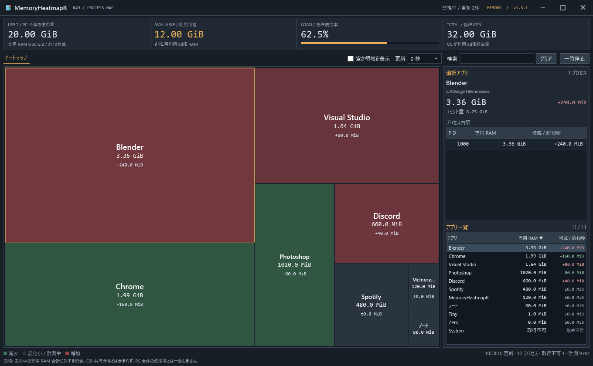
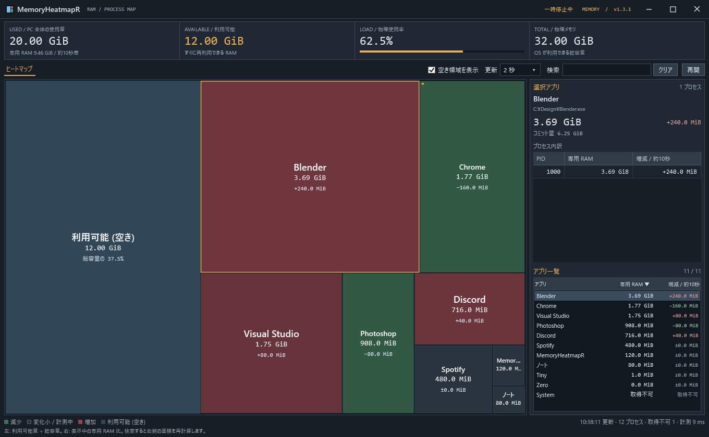

# MemoryHeatmapR

Windows のアプリ別メモリ使用量を、株価マップ風のヒートマップで表示するツールです。
四角の面積が専用 RAM 使用量、背景色は最近の増減傾向を示します。

## ダウンロード

**v1.3.0 / Windows 11 x64**

- **[最新版をダウンロード（v1.3.0・Windows x64・ZIP）](https://github.com/mezon-web/MemoryHeatmapR-Releases/releases/download/v1.3.0/MemoryHeatmapR-v1.3.0.zip)**
- [ZIP の SHA-256](https://github.com/mezon-web/MemoryHeatmapR-Releases/releases/download/v1.3.0/MemoryHeatmapR-v1.3.0.zip.sha256.txt)
- [画像付きの使い方をダウンロード（単一 HTML）](https://github.com/mezon-web/MemoryHeatmapR-Releases/releases/download/v1.3.0/MemoryHeatmapR-v1.3.0-manual.html)
- [更新内容](https://github.com/mezon-web/MemoryHeatmapR-Releases/releases/tag/v1.3.0) · [過去バージョン](https://github.com/mezon-web/MemoryHeatmapR-Releases/releases)

**.NET 10 Desktop Runtime（Windows x64）が必要です。実行環境は同梱していません。**
未導入の場合は [Microsoft の .NET 10 配布ページ](https://dotnet.microsoft.com/en-us/download/dotnet/10.0)から「.NET Desktop Runtime」の Windows x64 を導入してください。

ZIP を展開し、`MemoryHeatmapR-v1.3.0` フォルダ内の `MemoryHeatmapR.exe` をダブルクリックすると起動します。インストール・管理者権限は不要です。
EXE は単独で移動できます。Windows 11 22H2 の 2023 年 9 月更新以降が対象です。



## できること

- 同じ実行ファイルのフルパスでプロセスを合算し、専用 RAM 使用量の面積比で表示。
- 約 10 秒前との差を実測値で表示。更新間隔は0.5・1・2・5・10秒から選択。
- 背景色は半減期5秒でならした最近の増減傾向。短い揺れによる点滅を抑制。
- アプリ一覧はアプリ名・専用 RAM・増減の見出しから昇順／降順にソート。
- アプリ名、PID、パスで検索。選択アプリの PID 別内訳とコミット量を確認。
- 一時停止／再開、小さい四角のツールチップ、キーボード操作。
- PC 全体の使用量、利用可能量、使用率を表示。
- 「空き領域を表示」で左端に現在の利用可能 (空き) を追加。右側のアプリ表示と検索は従来どおり。
- 上部のタイトルバーにアプリアイコン、計測状態、ウィンドウ操作ボタンをまとめて表示。

日本語 UI、オフライン動作。四角・アプリ行・PID 行をダブルクリックすると整理の確認画面を開きます。右クリックから対象を確認して、メモリ整理・タスク終了・ファイルの場所を開く操作ができます。自動整理・自動常駐は行いません。

## 表示の読み方

背景色の赤は増加傾向、緑は減少傾向、暗色は変化が小さい状態または計測中です。色に使う符号付きの増減を半減期5秒でならし、±1 MiBで色を付け、絶対値0.5 MiB未満で暗色へ戻します。小さい傾向は淡く、大きい傾向は濃く表示します。使用量・増減の数値、四角の面積、ソートは実測値です。
起動・再開・更新間隔変更後は約 10 秒分の履歴を集めます。マップの初回配置は使用量順で、その後は既存アプリの配置順を維持します。一覧のソートでマップの配置順は変わりません。

空き領域 OFF の面積は、表示中に取得できたアプリのプライベートワーキングセットを基準にします。
OS・共有メモリなどを含む PC 全体の使用量とは一致しません。通常権限で情報を取得できないプロセスは「取得不可」となり、ゼロとして扱いません。

検索の左の「空き領域を表示」を ON にすると、左端に利用可能 (空き) を追加します。
空きの幅は利用可能量 ÷ 総物理メモリ。右側は表示中アプリの専用 RAM 比で配置し、検索すると右側を検索結果で再計算します。
アプリが 1 件だけなら右側をそのアプリが占め、検索結果なしでは右側は空白になります。空きの幅は検索に影響されません。
アプリの面積は右側での相対比です。利用可能量には再利用できるスタンバイメモリも含みます。
専用 RAM 合計と「約10秒差」の表示は、上部の PC 全体の使用量の下にあります。
初期設定は空き領域 OFF・更新2秒・専用 RAM 降順です。空き領域の選択・更新間隔・一覧のソート条件は EXE の隣の `MemoryHeatmapR.settings.json` に保存し、次回起動で復元します。旧 `MemoryHeatmap.settings.json` が同じ場所にあれば、初回起動時に設定を引き継ぎ、旧ファイルはバックアップとして残します。保存できない場合も現在の切り替えは有効です。



タスク終了は強制終了で、未保存のデータが失われる可能性があります。メモリ整理後もコミット量は残り、再アクセスで RAM 使用量が戻る場合があります。

詳しい操作は [使い方（HTML）](使い方.html) にまとめています。起動からアプリの確認までを3ステップで案内し、右クリック操作や困ったときの対処も読めます。
ZIP 内の `使い方.html` をブラウザーで開くと、画像付きでオフライン閲覧できます。説明書だけをダウンロードする場合も同じ内容です。画像は架空データによる画面例です。

## ファイルの確認

PowerShell で ZIP の SHA-256 を計算し、配布している `.sha256.txt` の値と照合できます。

```powershell
Get-FileHash .\MemoryHeatmapR-v1.3.0.zip -Algorithm SHA256
```

ZIP の内容は `MemoryHeatmapR.exe` と `使い方.html` です。
GitHub が自動表示する **Source code (zip / tar.gz)** は、この案内リポジトリの文書です。アプリを利用する場合は上記の名前付き ZIP をダウンロードしてください。

## 更新履歴

- [v1.3.0 — 操作・表示の改善](release-notes/v1.3.0.md)

- [v1.2.8](release-notes/v1.2.8.md)

- [v1.2.7](release-notes/v1.2.7.md)

- [v1.2.6 — タイトルバーとアプリヘッダーを統合](release-notes/v1.2.6.md)

- [v1.2.5 — チェックボックスの中央揃えと余白を調整](release-notes/v1.2.5.md)

- [v1.2.4 — 空き領域のチェックボックスを検索の左へ移動](release-notes/v1.2.4.md)

- [v1.2.3 — 更新処理の軽量化](release-notes/v1.2.3.md)

- [v1.2.2 — タイトルバーの表記を変更](release-notes/v1.2.2.md)

- [v1.2.1 — 空き領域だけを追加し、アプリ表示と配置を調整](release-notes/v1.2.1.md)

- [v1.2.0 — メモリ全体と空き領域の表示](release-notes/v1.2.0.md)

- [v1.1.2 — 確認画面のボタン名を簡潔に](release-notes/v1.1.2.md)

- [v1.1.1 — 右クリックメニューの区切り線を修正](release-notes/v1.1.1.md)

- [v1.1.0 — 右クリックからの手動整理・タスク終了](release-notes/v1.1.0.md)

- [v1.0.1 — メモリ使用と更新負荷の軽減](release-notes/v1.0.1.md)
- [v1.0.0 — 初回プレビュー版](release-notes/v1.0.0.md)

<!-- 配布案内の更新手順: 実行用Assetは版番号付きのため、次回リリース公開時にREADMEの版番号・直リンク・展開先名を新しいAssetに合わせて更新する。更新内容・過去バージョンへのリンクを残し、匿名のHEADリクエスト等で直リンクの到達先を確認する。GitHub Actionsは使用しない。 -->
