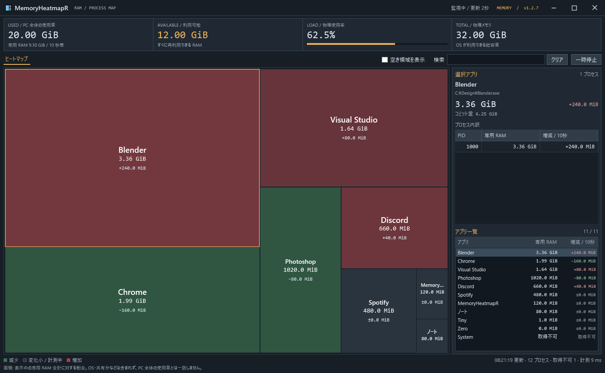
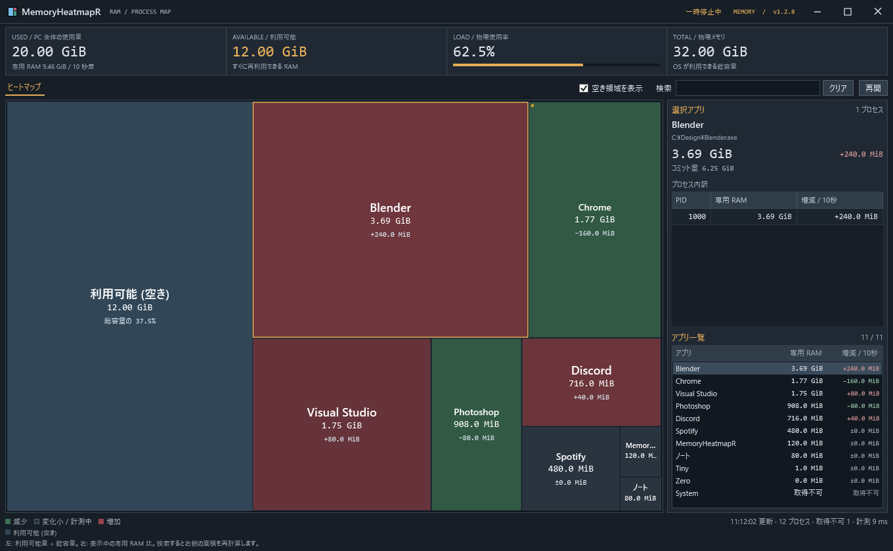

# MemoryHeatmapR

Windows のアプリ別メモリ使用量を、株価マップ風のヒートマップで表示するツールです。
四角の面積が専用 RAM 使用量、赤・緑の色が約 10 秒前からの増減を示します。



## ダウンロード

**v1.2.7 / Windows 11 x64**

- [MemoryHeatmapR-v1.2.7.zip](https://github.com/mezon-web/MemoryHeatmapR-Releases/releases/download/v1.2.7/MemoryHeatmapR-v1.2.7.zip)
- [ZIP の SHA-256](https://github.com/mezon-web/MemoryHeatmapR-Releases/releases/download/v1.2.7/MemoryHeatmapR-v1.2.7.zip.sha256.txt)
- [画像付きの使い方をダウンロード（単一 HTML）](https://github.com/mezon-web/MemoryHeatmapR-Releases/releases/download/v1.2.7/MemoryHeatmapR-v1.2.7-manual.html)
- [リリースページ](https://github.com/mezon-web/MemoryHeatmapR-Releases/releases/tag/v1.2.7)

**.NET 10 Desktop Runtime（Windows x64）が必要です。実行環境は同梱していません。**
未導入の場合は [Microsoft の .NET 10 配布ページ](https://dotnet.microsoft.com/en-us/download/dotnet/10.0)から「.NET Desktop Runtime」の Windows x64 を導入してください。

ZIP を展開し、`MemoryHeatmapR-v1.2.7` フォルダ内の `MemoryHeatmapR.exe` をダブルクリックすると起動します。インストール・管理者権限は不要です。
EXE は単独で移動できます。Windows 11 22H2 の 2023 年 9 月更新以降が対象です。

## できること

- 同じ実行ファイルのフルパスでプロセスを合算し、専用 RAM 使用量の面積比で表示。
- 約 10 秒前との差を数値と赤／緑で表示。2 秒ごとに更新。
- アプリ名、PID、パスで検索。選択アプリの PID 別内訳とコミット量を確認。
- 一時停止／再開、小さい四角のツールチップ、キーボード操作。
- PC 全体の使用量、利用可能量、使用率を表示。
- 「空き領域を表示」で左端に現在の利用可能 (空き) を追加。右側のアプリ表示と検索は従来どおり。
- 上部のタイトルバーにアプリアイコン、計測状態、ウィンドウ操作ボタンをまとめて表示。

日本語 UI、オフライン動作。右クリックから対象を確認して、メモリ整理・タスク終了・ファイルの場所を開く操作ができます。自動整理・自動常駐は行いません。

## 表示の読み方

赤は増加、緑は減少、暗色は変化が小さい状態または計測中です。1 MiB 未満の変化は暗色で、数値にはその差も表示します。
起動直後や再開直後は約 10 秒分の履歴を集めます。初回は使用量順で、その後は既存アプリの並びを維持します。

空き領域 OFF の面積は、表示中に取得できたアプリのプライベートワーキングセットを基準にします。
OS・共有メモリなどを含む PC 全体の使用量とは一致しません。通常権限で情報を取得できないプロセスは「取得不可」となり、ゼロとして扱いません。

検索の左の「空き領域を表示」を ON にすると、左端に利用可能 (空き) を追加します。
空きの幅は利用可能量 ÷ 総物理メモリ。右側は表示中アプリの専用 RAM 比で配置し、検索すると右側を検索結果で再計算します。
アプリが 1 件だけなら右側をそのアプリが占め、検索結果なしでは右側は空白になります。空きの幅は検索に影響されません。
アプリの面積は右側での相対比です。利用可能量には再利用できるスタンバイメモリも含みます。
専用 RAM 合計と「10 秒差」の表示は、上部の PC 全体の使用量の下にあります。
初回は OFF。以後は EXE の隣の `MemoryHeatmapR.settings.json` に選択を保存します。旧 `MemoryHeatmap.settings.json` が同じ場所にあれば、初回起動時に設定を引き継ぎ、旧ファイルはバックアップとして残します。保存できない場合も現在の切り替えは有効です。



タスク終了は強制終了で、未保存のデータが失われる可能性があります。メモリ整理後もコミット量は残り、再アクセスで RAM 使用量が戻る場合があります。

詳しい操作は [使い方（HTML）](使い方.html) にまとめています。起動からアプリの確認までを3ステップで案内し、右クリック操作や困ったときの対処も読めます。
ZIP 内の `使い方.html` をブラウザーで開くと、画像付きでオフライン閲覧できます。説明書だけをダウンロードする場合も同じ内容です。画像は架空データによる画面例です。

## ファイルの確認

PowerShell で ZIP の SHA-256 を計算し、配布している `.sha256.txt` の値と照合できます。

```powershell
Get-FileHash .\MemoryHeatmapR-v1.2.7.zip -Algorithm SHA256
```

ZIP の内容は `MemoryHeatmapR.exe` と `使い方.html` です。
GitHub が自動表示する **Source code (zip / tar.gz)** は、この案内リポジトリの文書です。アプリを利用する場合は上記の名前付き ZIP をダウンロードしてください。

## 更新履歴

- [v1.2.7](release-notes/v1.2.7.md)

- [v1.2.6 — タイトルバーとアプリヘッダーを統合](release-notes/v1.2.6.md)

- [v1.2.5 — チェックボックスの中央揃えと余白を調整](release-notes/v1.2.5.md)

- [v1.2.4 — 空き領域のチェックボックスを検索の左へ移動](release-notes/v1.2.4.md)

- [v1.2.3 — 更新処理の軽量化](release-notes/v1.2.3.md)

- [v1.2.2 — タイトルバーの表記を変更](release-notes/v1.2.2.md)

- [v1.2.1 — 空き領域だけを追加し、アプリ表示と配置を調整](release-notes/v1.2.1.md)

- [v1.2.0 — メモリ全体と空き領域の表示](release-notes/v1.2.0.md)

- [v1.1.2 — 確認画面のボタン名を簡潔に](release-notes/v1.1.2.md)

- [v1.1.1 — 右クリックメニューの区切り線を修正](release-notes/v1.1.1.md)

- [v1.1.0 — 右クリックからの手動整理・タスク終了](release-notes/v1.1.0.md)

- [v1.0.1 — メモリ使用と更新負荷の軽減](release-notes/v1.0.1.md)
- [v1.0.0 — 初回プレビュー版](release-notes/v1.0.0.md)
